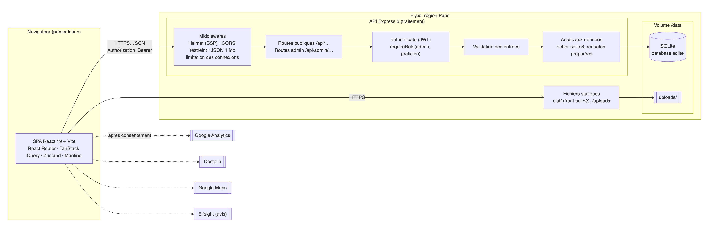

# Dossier de conception : site vitrine du cabinet d'ostéopathie

| | |
|---|---|
| Projet | Site vitrine administrable (bénévole) |
| Auteur | François Vittecoq, développeur |
| Cliente | La praticienne, ostéopathe D.O. à Vendargues |
| Version | 1.0, novembre 2026 |
| Dépôt | `FrancoisV34/Alissar-project` |
| Production | https://alissar-vitrine.fly.dev |

## Sommaire
1. Contexte et objectifs
2. Besoins (renvoi)
3. Maquettes et parcours
4. Architecture logicielle
5. Données
6. Sécurité
7. Réglementation : RGPD et accessibilité
8. Éco-conception et performance
9. Qualité, tests et déploiement
10. Choix techniques et alternatives écartées

---

## 1. Contexte et objectifs

La praticienne avait besoin d'un site présentant son cabinet, ses spécialités et ses informations pratiques, avec un renvoi vers Doctolib. Contrainte principale : **elle doit pouvoir modifier son site seule** (horaires, tarifs, textes, photos, apparence) sans faire appel à un développeur. Le projet est bénévole : le coût d'hébergement doit rester minimal.

Objectifs mesurables :
- toutes les informations pratiques accessibles en moins de deux défilements sur mobile ;
- prise de rendez-vous en un clic depuis chaque section clé ;
- 100 % du contenu modifiable depuis l'administration ;
- référencement local : JSON-LD `Physician`, sitemap, balises Open Graph.

## 2. Besoins

Détaillés dans [`besoins.md`](besoins.md) : 3 acteurs, 18 user stories avec critères d’acceptation, exigences non fonctionnelles et contraintes. Diagramme de cas d'utilisation : [`diagrammes/cas-utilisation.png`](diagrammes/cas-utilisation.png).

## 3. Maquettes et parcours

- **Version 1** (octobre 2025 à mai 2026) : développée directement à partir des échanges téléphoniques, sans maquette formelle.
- **Refonte** (mai 2026) : maquettée **en direct pendant des visios avec la cliente** à l'aide de Claude Design. Plusieurs variantes (palette, typographie, mise en page du Hero) ont été générées et comparées à l'écran ; la cliente a choisi en séance. Ces variantes sont devenues des options de l'administration (3 variantes de Hero, palettes, polices, mode sombre).
- **Responsive** : trois points de rupture (720, 880 et 1080 px). Sous 880 px, la barre du haut, qui reste visible au défilement, masque la navigation et ne conserve que les deux actions essentielles : « Appeler » et « Prendre RDV ».
- Enchaînement des écrans : [`enchainement-ecrans.md`](enchainement-ecrans.md).

## 4. Architecture logicielle

Architecture **trois tiers**, déployée dans un seul conteneur :

| Couche | Technologie | Rôle | Ne fait pas |
|---|---|---|---|
| Présentation | React 19, Vite, React Router 7, Mantine 8, SCSS | Affichage, formulaires, navigation | Aucune règle de sécurité définitive, aucun secret |
| Gestion d'état | TanStack Query (données serveur, cache), Zustand (session) | Cache des réponses API, invalidation après modification | |
| API | Express 5 | Routes REST publiques (`/api/...`) et d'administration (`/api/admin/...`) | Rendu HTML |
| Middlewares | Helmet, CORS, express-rate-limit, `authenticate`, `requireRole`, validation | Sécurité transverse appliquée avant toute logique | |
| Accès aux données | better-sqlite3 | Requêtes préparées, transactions | |
| Données | SQLite sur volume persistant | Stockage | Aucun accès réseau direct |

**Organisation du code serveur** : `server/app.js` construit l'application (middlewares, routes) sans démarrer le serveur, ce qui permet de la tester ; `server/index.js` la démarre. Une route par ressource, avec un routeur public et un routeur d'administration séparés : la protection est posée **une seule fois** en tête du routeur d'administration (`router.use(authenticate, requireRole(...))`), il n'est donc pas possible d'oublier de protéger une nouvelle route.

**Organisation du code client** : un hook par ressource (`useTarifs`, `useHoraires`…), des composants de présentation sans appel réseau, un `ThemeProvider` qui applique l'apparence choisie à partir d'une liste blanche.

## 5. Données

Voir [`modele-donnees.md`](modele-donnees.md) : modèle physique, dictionnaire de données, règles d'intégrité.

- Schéma versionné par migrations SQL numérotées (`server/migrations/`), appliquées au démarrage et tracées dans `schema_migrations`.
- Jeu d'essai de production (`seed.js`) et jeu d'essai de test déterministe (`seed-test.js`).
- Sauvegarde et restauration scriptées et testées (voir `DEPLOY.md`).

## 6. Sécurité

Analyse selon les critères **DICP** :

| Critère | Risque | Mesure |
|---|---|---|
| Disponibilité | Saturation, brute force | Limitation des connexions (20 / 15 min), limite de 1 Mo sur les corps JSON, sonde `/healthz`, redémarrage automatique Fly.io |
| Intégrité | Modification du contenu par un tiers, injection | Routes d'administration protégées par JWT + rôle, requêtes préparées, liste blanche des colonnes, validation des types |
| Confidentialité | Vol de mot de passe, fuite d'informations | bcrypt, secret JWT ≥ 32 caractères hors du dépôt, message d'erreur de connexion générique, erreurs 500 sans détail technique |
| Preuve | Qui a modifié quoi | Comptes nominatifs ; journal d'accès de la plateforme |

Mesures par couche (référence OWASP Top 10) :
- **Front** : HTML saisi par l'administration assaini avant affichage (DOMPurify) ; liens externes en `rel="noopener noreferrer"`.
- **Transport** : HTTPS forcé, HSTS.
- **En-têtes** : Content-Security-Policy restreinte aux domaines nécessaires (Google Analytics, Google Maps, Elfsight), `X-Frame-Options`, `nosniff`.
- **API** : CORS limité au domaine du site ; rôles contrôlés côté serveur ; rôle `admin` non attribuable par l'API ; politique de mot de passe (12 caractères minimum).
- **Fichiers envoyés** : images uniquement (JPEG, PNG, WebP, GIF), 8 Mo maximum, nom de fichier réécrit ; le SVG est refusé car il peut contenir du script.
- **Dépendances** : `npm audit` et analyse des secrets (gitleaks) dans la CI ; Dependabot.
- **Conteneur** : exécution par un utilisateur non-root.

Le détail des constats et des corrections est dans [`../securite/AUDIT.md`](../securite/AUDIT.md).

## 7. Réglementation

**RGPD.** Le site ne collecte aucune donnée de santé ni de formulaire patient. Google Analytics n'est chargé qu'après consentement explicite (bandeau, choix mémorisé), avec anonymisation de l'adresse IP. Les seules données personnelles stockées sont les comptes d'administration.

**Accessibilité (RGAA).** Objectif : niveau AA sur les pages publiques. Contrôles : Lighthouse et axe-core, corrections tracées dans [`../accessibilite/AUDIT.md`](../accessibilite/AUDIT.md). Textes alternatifs éditables pour chaque image.

## 8. Éco-conception et performance

- Une seule page publique, pas de rechargement : les données sont chargées une fois puis mises en cache (TanStack Query).
- Fichiers du front avec empreinte dans le nom, mis en cache par le navigateur ; images servies avec 7 jours de cache.
- Machine Fly.io arrêtée automatiquement en l'absence de trafic (`auto_stop_machines`), 256 Mo de mémoire.
- Pas de base de données managée ni de service externe payant.

## 9. Qualité, tests et déploiement

- Analyse statique : ESLint.
- Tests : unitaires (composants React), intégration (API sur base temporaire), sécurité, bout en bout (Playwright), charge, fuzzing. Voir [`../tests/PLAN_DE_TESTS.md`](../tests/PLAN_DE_TESTS.md).
- Intégration continue GitHub Actions : lint, tests, couverture, e2e, audit, image Docker.
- Déploiement continu sur Fly.io, conditionné à la réussite de la CI. Procédure et retour arrière : [`../../DEPLOY.md`](../../DEPLOY.md).

## 10. Choix techniques et alternatives écartées

| Besoin | Choix | Alternative écartée | Raison |
|---|---|---|---|
| Contenu modifiable | Back-office maison | CMS (WordPress) | Maintenance et sécurité d'un CMS complet disproportionnées pour un site d'une page ; interface plus simple pour la cliente |
| Base de données | SQLite | PostgreSQL managé | Un seul serveur, trafic faible, coût nul ; sauvegarde par simple copie du fichier |
| Hébergement | Fly.io (Paris) | VPS | Pas d'administration système, HTTPS automatique, arrêt à vide |
| Rendez-vous | Lien Doctolib | Module de réservation | Déjà utilisé par la cliente ; évite de stocker des données de santé |
| Mesure d'audience | GA4 avec consentement | Pas de mesure | Demande de la cliente ; conformité assurée par le consentement préalable |
