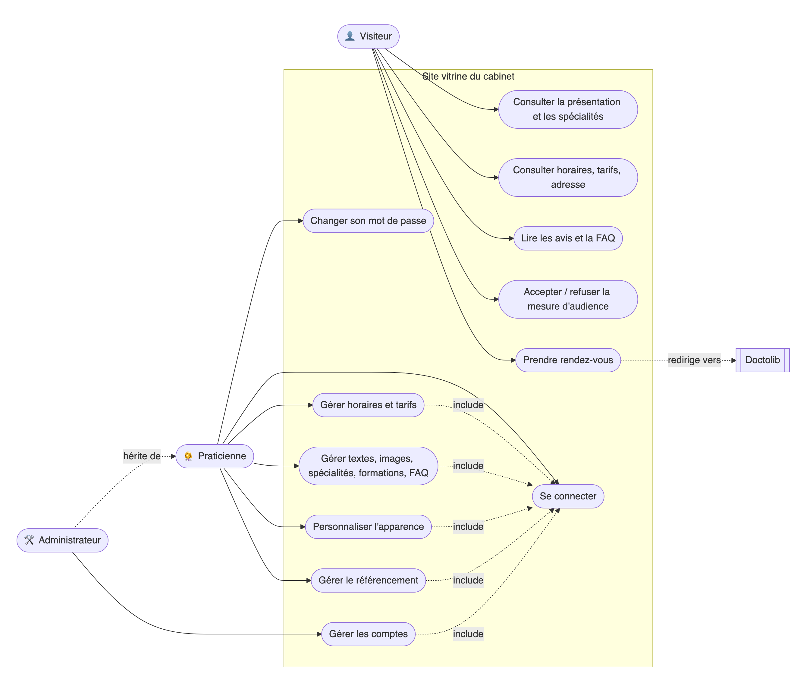

# Expression des besoins : site vitrine du cabinet d'ostéopathie

> Document de conception n° 1. Sources : échanges téléphoniques et démonstrations en visio avec la praticienne (cliente), puis analyse du site livré.
> Les points marqués **[À CONFIRMER]** doivent être validés avec la cliente.

## 1. Contexte

La praticienne exerce en cabinet libéral à Vendargues. Elle veut un site qui :
- présente le cabinet, ses spécialités (santé de la femme, fertilité, grossesse, sport) et sa formation ;
- donne les informations pratiques (adresse, horaires, tarifs, téléphone) ;
- renvoie vers la prise de rendez-vous en ligne (Doctolib), sans la remplacer ;
- soit bien référencé localement (Google, fiche d'établissement) ;
- puisse être **mis à jour par elle-même**, sans développeur, pour les horaires, les tarifs et les textes.

Le site ne gère **aucune donnée de santé** : la prise de rendez-vous reste chez Doctolib.

## 2. Acteurs

| Acteur | Description | Accès |
|---|---|---|
| **Visiteur (patient)** | Toute personne qui consulte le site, sans compte | Pages publiques |
| **Praticienne** | La cliente, rôle `praticien` | Espace d'administration du contenu **[À CONFIRMER : se connecte-t-elle elle-même ?]** |
| **Administrateur** | Le développeur (François), rôle `admin` | Tout, y compris la gestion des comptes ; ne peut pas être supprimé ni rétrogradé |
| **Services externes** | Doctolib, Google Maps, Google Analytics, Elfsight (avis Google) | Appelés depuis le navigateur |

## 3. Cas d'utilisation

Source : [`diagrammes/cas-utilisation.mmd`](diagrammes/cas-utilisation.mmd)

## 4. User stories et critères d'acceptation

Format : *En tant que … je veux … afin de …*. Priorité MoSCoW : **M** (must), **S** (should), **C** (could).

### Visiteur

| ID | User story | Prio | Critères d'acceptation |
|---|---|---|---|
| US-01 | En tant que visiteur, je veux voir en arrivant qui est la praticienne et ce qu'elle soigne, afin de savoir si le cabinet me correspond | M | Le Hero affiche le titre, le sous-titre et une photo ; les spécialités sont listées sous forme de cartes |
| US-02 | En tant que visiteur, je veux prendre rendez-vous en un clic, afin de ne pas chercher le lien | M | Un bouton « Prendre RDV » est visible dans l'en-tête, le Hero et la section pratique ; il ouvre Doctolib dans un nouvel onglet |
| US-03 | En tant que visiteur sur mobile, je veux appeler le cabinet directement, afin de joindre la praticienne vite | M | Sous 720 px, une barre fixe propose « Appeler » (lien `tel:`) et « Prendre RDV » |
| US-04 | En tant que visiteur, je veux consulter les horaires, les tarifs et l'adresse avec un plan, afin de préparer ma venue | M | La section « Pratique » affiche les horaires par jour, les tarifs en euros et une carte Google Maps |
| US-05 | En tant que visiteur, je veux lire les avis d'autres patients, afin d'être rassuré | S | La note moyenne et le nombre d'avis s'affichent ; le widget d'avis peut être masqué par la praticienne |
| US-06 | En tant que visiteur, je veux trouver les réponses aux questions fréquentes, afin d'éviter un appel | S | La FAQ s'affiche en accordéon ; elle peut être masquée |
| US-07 | En tant que visiteur, je veux choisir si j'accepte la mesure d'audience, afin de protéger ma vie privée | M | Un bandeau de consentement s'affiche à la première visite ; Google Analytics n'est chargé **qu'après** acceptation ; le refus est mémorisé |
| US-08 | En tant que visiteur, je veux un site lisible et utilisable au clavier, afin d'y accéder quel que soit mon handicap | S | Contrastes suffisants, textes alternatifs sur les images, navigation au clavier (voir audit d'accessibilité) |

### Praticienne

| ID | User story | Prio | Critères d'acceptation |
|---|---|---|---|
| US-10 | En tant que praticienne, je veux me connecter à un espace privé, afin de modifier mon site | M | Connexion par e-mail et mot de passe ; message d'erreur générique en cas d'échec ; blocage après 20 essais en 15 min |
| US-11 | En tant que praticienne, je dois changer le mot de passe provisoire à la première connexion, afin que personne d'autre ne le connaisse | M | Tant que `must_change_password` vaut 1, toute page protégée redirige vers le changement de mot de passe |
| US-12 | En tant que praticienne, je veux modifier mes horaires et mes tarifs, afin que le site reste à jour | M | Ajout, modification, suppression ; le site public reflète le changement au rechargement |
| US-13 | En tant que praticienne, je veux modifier les textes et photos (Hero, À propos, spécialités, formations, FAQ), afin de présenter mon activité à ma façon | M | Chaque bloc est éditable dans un onglet ; envoi d’image (JPEG, PNG, WebP ou GIF, 8 Mo maximum) |
| US-14 | En tant que praticienne, je veux changer l'apparence (palette, police, variante du Hero, mode sombre), afin que le site me ressemble | S | Les choix sont pris dans une liste fermée (pas de CSS libre) et appliqués immédiatement |
| US-15 | En tant que praticienne, je veux renseigner les informations de référencement (titre, description, image de partage, identifiants Google), afin d'être bien trouvée | S | Les balises `meta`, Open Graph et les données structurées JSON-LD sont générées à partir de ces champs |
| US-16 | En tant que praticienne, je veux afficher ou masquer des sections (formations, avis, FAQ), afin d'adapter la page | C | Une case par section ; le plan du site (`sitemap.xml`) suit ces choix |

### Administrateur

| ID | User story | Prio | Critères d'acceptation |
|---|---|---|---|
| US-20 | En tant qu'administrateur, je veux créer le compte de la praticienne avec un mot de passe provisoire, afin de lui donner accès | M | Le compte est créé avec `must_change_password = 1` ; un e-mail déjà utilisé renvoie une erreur 409 |
| US-21 | En tant qu'administrateur, je veux qu'aucun compte ne puisse s'attribuer le rôle admin, afin de garder la maîtrise du site | M | Seuls les rôles de la liste autorisée sont acceptés ; un admin ne peut être ni supprimé ni rétrogradé |
| US-22 | En tant qu'administrateur, je veux que le premier démarrage crée la base et un compte admin, afin de déployer sans manipulation manuelle | M | Base vide : seed automatique ; aucun admin : création depuis `ADMIN_EMAIL` / `ADMIN_PASSWORD` ou mot de passe aléatoire affiché une fois |

## 5. Exigences non fonctionnelles

| Domaine | Exigence |
|---|---|
| Sécurité | Mots de passe hachés (bcrypt), jeton JWT signé, routes d'administration protégées par rôle, en-têtes HTTP de sécurité, CORS restreint, limitation des tentatives de connexion |
| RGPD | Aucune donnée de santé ; mesure d'audience soumise à consentement ; seuls les comptes d'administration sont des données personnelles |
| Accessibilité | Viser la conformité RGAA (niveau AA) sur les pages publiques |
| Performance / éco-conception | Page unique légère, images compressées, cache HTTP sur les fichiers statiques, machine arrêtée automatiquement quand il n'y a pas de visite |
| Référencement | Balises meta, Open Graph, JSON-LD `Physician`, `robots.txt`, `sitemap.xml` |
| Disponibilité | Hébergement Fly.io (Paris), sonde de santé `/healthz`, données sur volume persistant |
| Maintenabilité | Contenu entièrement administrable ; code testé et intégré en continu |

## 6. Contraintes

- Budget nul (projet bénévole) : hébergement le moins cher possible, pas de base de données managée.
- Un seul développeur.
- La cliente n'est pas technicienne : l'interface d'administration doit être simple, en français.
- La prise de rendez-vous reste sur Doctolib (obligation de la cliente, déjà utilisée par ses patients).
