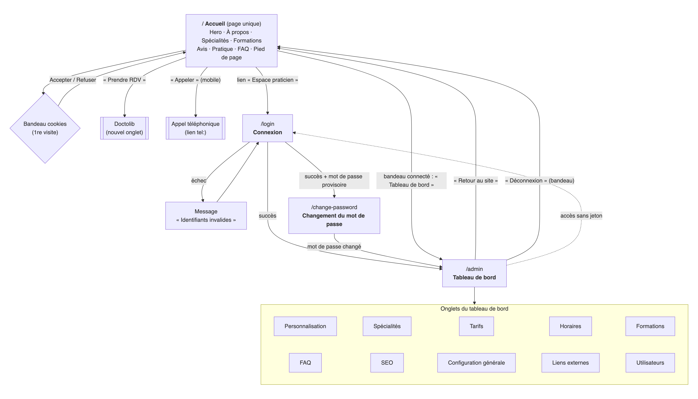

# Schéma d'enchaînement des écrans

> Document de conception n° 2. Il formalise la navigation entre les maquettes réalisées en direct avec la cliente (Claude Design, pendant les visios), puis implémentées en React.

Source : [`diagrammes/enchainement-ecrans.mmd`](diagrammes/enchainement-ecrans.mmd)

## Écrans

| Route | Écran | Accès | Composant |
|---|---|---|---|
| `/` | Accueil, page unique à ancres (`#about`, `#specialties`, `#formations`, `#reviews`, `#pratique`, `#faq`) | Public | `VitrineLayout` + `Homepage` |
| `/login` | Connexion | Public | `LoginPage` |
| `/change-password` | Changement du mot de passe (obligatoire si provisoire) | Connecté | `ChangePasswordPage` |
| `/admin` | Tableau de bord à 10 onglets | Rôle `admin` ou `praticien` | `AdminDashboard` |

## Règles de navigation

1. Toute route protégée sans jeton renvoie vers `/login` (`ProtectedRoute`).
2. Un compte dont le mot de passe est provisoire (`must_change_password = 1`) est renvoyé vers `/change-password` tant qu'il ne l'a pas changé.
3. Un rôle non autorisé est renvoyé vers l'accueil.
4. Une fois connectée, la praticienne voit sur l'accueil un bandeau « Espace praticien » avec les liens « Tableau de bord », « Nouveau RDV » et « Déconnexion ».
5. Les liens « Prendre RDV » ouvrent Doctolib dans un nouvel onglet (`rel="noopener noreferrer"`).
6. Le contrôle côté front n'est qu'un confort d'affichage : **chaque appel à `/api/admin/*` est revérifié par l'API** (jeton et rôle).
