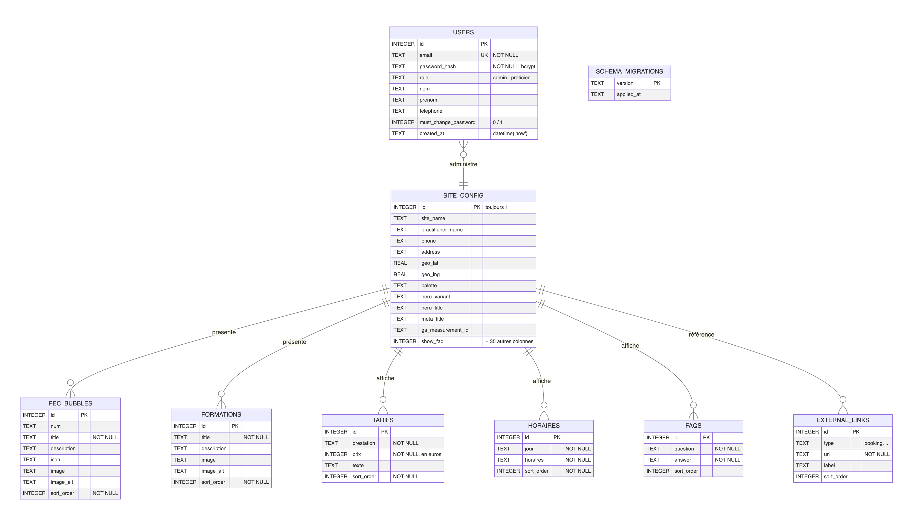

# Modèle de données

> Document de conception n° 3. Base SQLite (fichier unique sur un volume persistant), accédée avec `better-sqlite3`.

Source : [`diagrammes/modele-donnees.mmd`](diagrammes/modele-donnees.mmd)

## Choix de modélisation

- **Contenu éditorial en tables indépendantes.** Le site présente un seul cabinet : chaque bloc de contenu (spécialités, formations, tarifs, horaires, FAQ, liens externes) est une table ordonnée par `sort_order`. Il n'y a pas de clé étrangère entre elles : les associations du diagramme sont conceptuelles (tout appartient à l'unique cabinet).
- **Configuration en ligne unique.** `site_config` contient une seule ligne (`id = 1`) avec tous les réglages (identité, apparence, SEO). Une table clé/valeur aurait été plus souple mais aurait perdu le typage et les valeurs par défaut des colonnes.
- **Comptes séparés du contenu.** `users` ne contient que les comptes d'administration ; aucune donnée patient n'est stockée (la prise de rendez-vous reste chez Doctolib), ce qui limite le périmètre RGPD.
- **Versionnement du schéma.** `schema_migrations` enregistre les scripts d'évolution appliqués (voir `server/migrations/`).

## Dictionnaire de données (extrait)

| Table | Colonne | Type | Contraintes | Description |
|---|---|---|---|---|
| users | id | INTEGER | PK, auto-incrément | Identifiant |
| users | email | TEXT | NOT NULL, UNIQUE | Identifiant de connexion |
| users | password_hash | TEXT | NOT NULL | Empreinte bcrypt (coût 10), jamais renvoyée par l'API |
| users | role | TEXT | NOT NULL, `admin` ou `praticien` | Contrôle d'accès |
| users | must_change_password | INTEGER | NOT NULL, défaut 0 | 1 = mot de passe provisoire à changer |
| users | created_at | TEXT | NOT NULL, défaut `datetime('now')` | Date de création |
| site_config | id | INTEGER | PK, toujours 1 | Ligne unique |
| site_config | palette, font_title, hero_variant | TEXT | valeurs d'une liste fermée | Apparence |
| site_config | hero_title, about_text… | TEXT | HTML limité, assaini à l'affichage | Textes éditables |
| site_config | show_formations, show_reviews, show_faq | INTEGER | 0/1 | Affichage des sections |
| tarifs | prix | INTEGER | NOT NULL | Prix en euros |
| horaires | jour, horaires | TEXT | NOT NULL | Ex. « Lundi », « 9h – 19h » |
| external_links | type | TEXT | NOT NULL | `booking` = lien Doctolib |
| external_links | url | TEXT | NOT NULL, `http(s)://` uniquement | Lien sortant |
| * | sort_order | INTEGER | | Ordre d'affichage |

## Intégrité et sécurité

| Règle | Où elle est garantie |
|---|---|
| Un e-mail = un compte | Index `UNIQUE` sur `users.email` |
| Champs obligatoires | `NOT NULL` en base **et** validation dans l'API (erreur 400) |
| Pas d'injection SQL | Requêtes préparées partout ; colonnes modifiables via une liste blanche |
| Mot de passe illisible | bcrypt ; la colonne n'est jamais sélectionnée dans les réponses |
| Accès au fichier de base | Volume non exposé, processus non-root, aucun port réseau de base de données |
| Restauration possible | Sauvegarde à chaud (`scripts/backup.js`) et restauration testée (`scripts/restore.js`) |

**Limite assumée :** SQLite ne gère pas d'utilisateurs ni de droits (`GRANT`). Le moindre privilège est appliqué au niveau du système (processus non-root, fichier accessible au seul processus). La gestion d'un utilisateur applicatif aux droits restreints est traitée sur le projet Breath for All (MySQL).
